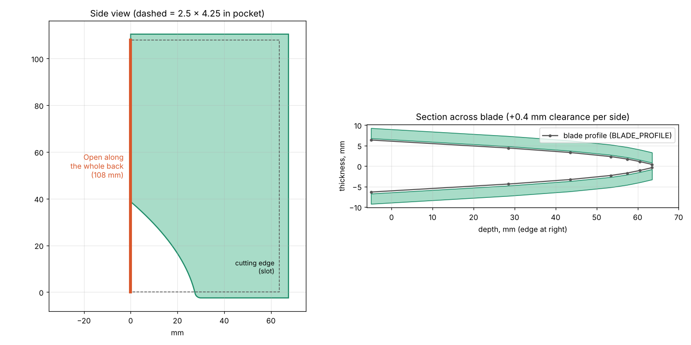

# Axe Cover

Parametric, 3D-printable TPU blade cover for competition throwing hatchets.



## Design

- Blade pocket: 2.5 in deep × 4.25 in along the edge (covers the 4 in legal edge max)
- Pocket is open along the entire back (full 4.25 in), so the whole cutting edge can slide in
- Pocket thickness follows `BLADE_PROFILE` (blade thickness measured back from the edge) plus `CLEARANCE` per side. The defaults are estimates; replace them with caliper readings from your blade
- 2.5 mm face walls, 4 mm wall in front of the edge
- Retention: a nub on each face, plus an optional 148 × 12 × 2 mm strap with 3 adjustment holes

## Files

| File | What it is |
| --- | --- |
| `axe_cover.py` | Parametric generator (edit the parameters at the top) |
| `axe_blade_cover.3mf` | Full cover + optional strap, already in print orientation |
| `axe_blade_cover_fit_test.3mf` | 12 mm band through the middle of the cover, to check the wedge fit on your blade first |
| `axe_cover_preview.png` | Side view, cross-section and print orientation |

## Printing

- Material: TPU
- Orientation: blade's top edge on the bed, cutting edge vertical, no supports (the 3MF is already oriented)
- Print the fit-test band first and slide it onto the blade from the back. If it is too tight or too loose, adjust `BLADE_PROFILE` or `CLEARANCE` and regenerate.

## Regenerating

```sh
pip install manifold3d numpy
python axe_cover.py axe_blade_cover.3mf   # also writes axe_blade_cover_fit_test.3mf
```
